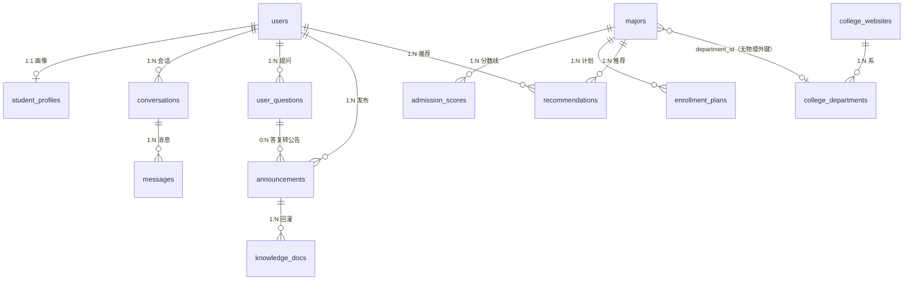

# AI招生助手 数据库表结构说明

> 数据库：MySQL 8.0，库名 `aistudent`，字符集 `utf8mb4`
> ORM 定义：[database/models.py](database/models.py)
> 统计时间：2026-11-13（行数为当时实际值）

共 **16 张表**、**13 条外键约束**、**0 条表/字段注释**（MySQL 层无 COMMENT，本文档为唯一完整说明）。

## 1. 表总览

| 表名 | 含义 | 行数 | 主键 | 唯一键 |
|---|---|---|---|---|
| `users` | 用户账号与角色 | 4 | id | username |
| `student_profiles` | 考生画像，与用户 1:1 | 3 | id | user_id |
| `majors` | 专业维度表 | 76 | id | (name, major_attr) |
| `admission_scores` | 分年度/省份/科类的专业录取分数 | 2271 | id | (year, province, plan_type, major_type, major_id) |
| `enrollment_plans` | 分年度/省份/科类的招生计划与学费 | 2175 | id | (year, province, plan_type, major_type, major_id) |
| `school_admission_scores` | 院校（专业组）投档线，不含具体专业 | 392 | id | (year, province, major_type, batch, group_name, plan_type) |
| `score_rank_segments` | 一分一段表 | 548 | id | (province, year, major_type, score) |
| `knowledge_docs` | 知识库文档分块（政策/专业/问答/敏感/公告） | 140 | id | (category, title) |
| `college_websites` | 学院官网链接 | 21 | id | name |
| `college_departments` | 学院下属系/教研室等单位 | 58 | id | (college_website_id, name) |
| `announcements` | 管理员公告 | 1 | id | — |
| `conversations` | 会话 | 51 | id | — |
| `messages` | 会话消息 | 234 | id | — |
| `user_questions` | 用户向学校提交的提问与答复 | 1 | id | — |
| `recommendations` | 专业推荐记录 | 0 | id | — |
| `system_settings` | 运行时配置（覆盖 .env） | 1 | key | key |

## 2. 关系图



文字版：

```
users(id)
 ├─ student_profiles.user_id            1:1
 ├─ conversations.user_id              1:N → messages.conversation_id
 ├─ user_questions.user_id             1:N → user_questions.answered_by 也指向 users
 ├─ announcements.created_by           1:N
 └─ recommendations.user_id            1:N

majors(id)
 ├─ admission_scores.major_id          1:N
 ├─ enrollment_plans.major_id          1:N
 ├─ recommendations.major_id           1:N
 └─ department_id → college_departments.id（代码声明，库中无 FK 约束）

announcements(id)
 └─ knowledge_docs.source_announcement_id  1:N（公告回灌知识库）

user_questions(id)
 └─ announcements.related_question_id     1:N（答复后转公告）

college_websites(id)
 └─ college_departments.college_website_id 1:N
```

## 3. 字段说明

### 3.1 专业与招生事实（5 张）

#### `majors` — 专业维度表

身份 = 归一化名称 + 专业属性，同名不同属性（如「化学」与「化学（公费师范）」）是两条记录。

| 字段 | 类型 | 空 | 键 | 说明 |
|---|---|---|---|---|
| id | int | 否 | PK | 自增主键 |
| name | varchar(100) | 否 | IDX | 归一化专业名（全角半角已统一，去掉括号后缀） |
| display_name | varchar(120) | 否 | — | 前端展示名，含培养类型后缀 |
| major_attr | varchar(20) | 否 | UQ | 专业属性，当前只有「普通类」「师范类」两种；公费师范、优师专项等培养类型体现在 `display_name` |
| department | varchar(100) | 是 | — | 所属学院名称，专业归属直答直接读此字段 |
| department_id | int | 是 | — | 指向 `college_departments.id`，系级归属（代码声明 FK，库中无约束） |
| subject_requirement | varchar(100) | 是 | — | 选科要求 |
| description | text | 是 | — | 专业简介 |
| created_at | datetime | 否 | — | 创建时间 |

#### `admission_scores` — 专业录取分数事实表

唯一键必须含 `major_type`，否则物理类与历史类会互相覆盖。

| 字段 | 类型 | 空 | 键 | 说明 |
|---|---|---|---|---|
| id | int | 否 | PK | 自增主键 |
| year | smallint | 否 | IDX | 招生年份 |
| province | varchar(20) | 否 | IDX | 生源省份 |
| plan_type | varchar(30) | 否 | UQ | 计划类型，见 4.1 |
| major_type | varchar(30) | 否 | UQ | 科类，见 4.2 |
| major_id | int | 否 | FK/IDX | → `majors.id` |
| min_score | int | 是 | — | 最低录取分（普通类为投档/录取分，艺术体育为综合分） |
| min_rank | int | 是 | — | 最低分对应位次；**0 表示该计划未公布位次**，用 `if min_rank` 判断 |
| baseline | int | 是 | — | 省控线（批次线） |
| min_culture_score | int | 是 | — | 艺术/体育类最低文化分 |
| max_culture_score | int | 是 | — | 艺术/体育类最高文化分 |
| avg_culture_score | int | 是 | — | 艺术/体育类平均文化分 |
| min_major_score | int | 是 | — | 艺术/体育类最低专业（术科）分 |
| max_major_score | int | 是 | — | 艺术/体育类最高专业分 |
| avg_major_score | int | 是 | — | 艺术/体育类平均专业分 |
| max_score | int | 是 | — | 最高录取分 |
| max_rank | int | 是 | — | 最高分对应位次 |
| avg_score | int | 是 | — | 平均分 |
| created_at | datetime | 否 | — | 创建时间 |
| updated_at | datetime | 否 | — | 更新时间，导入时随记录更新 |

#### `enrollment_plans` — 招生计划事实表

与分数线同键设计，可与 `admission_scores` 按五列唯一键直接对齐。

| 字段 | 类型 | 空 | 键 | 说明 |
|---|---|---|---|---|
| id | int | 否 | PK | 自增主键 |
| year | smallint | 否 | IDX | 招生年份 |
| province | varchar(20) | 否 | IDX | 生源省份 |
| plan_type | varchar(30) | 否 | UQ | 计划类型 |
| major_type | varchar(30) | 否 | UQ | 科类 |
| major_id | int | 否 | FK/IDX | → `majors.id` |
| plan_count | int | 是 | — | 招生计划人数 |
| edu_len | varchar(10) | 是 | — | 学制，如「四年」「五年」 |
| tuition | int | 是 | — | 学费数值（元/年） |
| tuition_raw | varchar(20) | 是 | — | 学费原始文本，保留「免费」等非数字语义 |
| created_at | datetime | 否 | — | 创建时间 |
| updated_at | datetime | 否 | — | 更新时间 |

#### `school_admission_scores` — 院校（专业组）投档线

不含具体专业，用于「学校最低投档线」这类问题；目前只有 2025 年数据。

| 字段 | 类型 | 空 | 键 | 说明 |
|---|---|---|---|---|
| id | int | 否 | PK | 自增主键 |
| year | smallint | 否 | IDX | 年份 |
| province | varchar(20) | 否 | IDX | 省份 |
| major_type | varchar(30) | 否 | UQ | 科类 |
| batch | varchar(30) | 否 | UQ | 批次，默认空串，如「本科批」 |
| group_name | varchar(30) | 否 | UQ | 专业组代码/名称，默认空串 |
| plan_type | varchar(30) | 否 | UQ | 计划类型 |
| subject_requirement | varchar(100) | 是 | — | 选科要求 |
| min_score | int | 是 | — | 投档最低分 |
| min_rank | int | 是 | — | 投档最低位次 |

#### `score_rank_segments` — 一分一段表

同省同年同科类下，每个分数对应的人数与累计人数，用于分数与位次互算。

| 字段 | 类型 | 空 | 键 | 说明 |
|---|---|---|---|---|
| id | int | 否 | PK | 自增主键 |
| province | varchar(20) | 否 | IDX | 省份 |
| year | int | 否 | IDX | 年份 |
| major_type | varchar(30) | 否 | UQ | 科类 |
| score | int | 否 | UQ | 分数 |
| segment_count | int | 否 | — | 本段人数（该分数的考生数） |
| cumulative_count | int | 否 | — | 累计人数，即位次上限 |
| source_url | varchar(500) | 是 | — | 数据来源页 |
| updated_at | datetime | 否 | — | 更新时间 |

### 3.2 知识库与运营（4 张）

#### `knowledge_docs` — 知识库文档分块

长文档按约 600 字切块入库，供关键词检索；公告发布时同步回灌，下架时删除对应条目。

| 字段 | 类型 | 空 | 键 | 说明 |
|---|---|---|---|---|
| id | int | 否 | PK | 自增主键 |
| category | varchar(30) | 否 | IDX/UQ | 分类，见 4.3 |
| title | varchar(200) | 否 | UQ | 标题（分块标题 = 文档名 + 序号） |
| content | text | 否 | — | 正文分块 |
| source_file | varchar(255) | 是 | — | 来源文件名 |
| source_type | varchar(20) | 否 | — | `file` 文件导入 / `announcement` 公告回灌 |
| source_announcement_id | int | 是 | FK/IDX | → `announcements.id`，公告回灌时写入 |
| sensitivity_level | smallint | 否 | — | 0 普通 / 1 敏感（`sensitive` 类） |
| keywords | varchar(255) | 是 | — | 检索加权关键词 |
| updated_at | datetime | 否 | — | 更新时间 |

#### `college_websites` — 学院官网链接

问答中识别到学院名时，由系统从这里取链接附在回答末尾，模型不得自行生成网址。

| 字段 | 类型 | 空 | 键 | 说明 |
|---|---|---|---|---|
| id | int | 否 | PK | 自增主键 |
| name | varchar(100) | 否 | UNI | 学院标准名称 |
| aliases | varchar(255) | 是 | — | 逗号分隔别名，如「新闻学院」 |
| url | varchar(255) | 否 | — | 官网地址 |
| is_enabled | smallint | 否 | IDX | 1 启用 / 0 停用，停用后不返回链接 |
| updated_at | datetime | 否 | — | 更新时间 |

#### `college_departments` — 学院下属系级单位

学院下的系/教研室/书院，是 `majors.department_id` 的指向目标。

| 字段 | 类型 | 空 | 键 | 说明 |
|---|---|---|---|---|
| id | int | 否 | PK | 自增主键 |
| college_website_id | int | 否 | FK/IDX | → `college_websites.id` |
| college | varchar(100) | 否 | IDX | 学院名称（冗余，便于按学院直接过滤） |
| name | varchar(100) | 否 | UQ | 系/教研室名称 |
| evidence | varchar(255) | 是 | — | 采集依据原文片段 |
| source_url | varchar(255) | 是 | — | 来源页面 |
| is_enabled | smallint | 否 | IDX | 1 启用 / 0 停用 |
| updated_at | datetime | 否 | — | 更新时间 |

#### `announcements` — 公告

发布/编辑时回灌知识库，下架时删除知识库条目；同步结果单独记录，不回滚公告状态。

| 字段 | 类型 | 空 | 键 | 说明 |
|---|---|---|---|---|
| id | int | 否 | PK | 自增主键 |
| title | varchar(200) | 否 | — | 公告标题 |
| content | text | 否 | — | 公告正文 |
| category | varchar(30) | 否 | — | 公告分类 |
| related_question_id | int | 是 | FK/IDX | → `user_questions.id`，由提问答复转成的公告 |
| is_published | smallint | 否 | IDX | 1 已发布 / 0 草稿或已下架 |
| published_at | datetime | 是 | — | 发布时间 |
| created_by | int | 否 | FK/IDX | → `users.id`，发布管理员 |
| view_count | int | 否 | — | 浏览次数 |
| knowledge_synced | smallint | 否 | — | 0 未同步 / 1 同步成功 / 2 同步失败 |
| created_at | datetime | 否 | — | 创建时间 |

### 3.3 用户与问答（5 张）

#### `users` — 用户账号

| 字段 | 类型 | 空 | 键 | 说明 |
|---|---|---|---|---|
| id | int | 否 | PK | 自增主键 |
| username | varchar(50) | 否 | UNI/IDX | 登录名 |
| password_hash | varchar(255) | 否 | — | 密码哈希，不存明文 |
| role | varchar(20) | 否 | — | `admin` 管理员 / `user` 普通用户，鉴权按此字段 |
| created_at | datetime | 否 | — | 注册时间 |

#### `student_profiles` — 考生画像

与用户 1:1，是分数查询、推荐、科类判断的兜底信息来源。

| 字段 | 类型 | 空 | 键 | 说明 |
|---|---|---|---|---|
| id | int | 否 | PK | 自增主键 |
| user_id | int | 否 | FK/UNI | → `users.id`，一个用户一条 |
| province | varchar(20) | 否 | — | 生源省份，分数类问题必需 |
| score | int | 是 | — | 高考分数 |
| rank_no | int | 是 | — | 省内位次 |
| subject_combo | varchar(50) | 是 | — | 选科组合或科类 |
| interest_tags | varchar(200) | 是 | — | 兴趣标签 |
| career_intent | varchar(50) | 是 | — | 职业意向 |
| adjust_accepted | smallint | 是 | — | 1 接受调剂 / 0 不接受 / NULL 未填 |
| exam_year | int | 是 | — | 高考年份 |
| special_qualification | varchar(50) | 是 | — | 特殊资格（专项、艺体等） |
| preferred_regions | varchar(200) | 是 | — | 意向地区 |
| updated_at | datetime | 否 | — | 更新时间 |

#### `conversations` — 会话

| 字段 | 类型 | 空 | 键 | 说明 |
|---|---|---|---|---|
| id | int | 否 | PK | 自增主键 |
| user_id | int | 否 | FK/IDX | → `users.id` |
| title | varchar(200) | 是 | — | 会话标题，取首条提问摘要 |
| created_at | datetime | 否 | — | 创建时间 |
| last_active_at | datetime | 否 | — | 最后活跃时间，用于会话排序 |

#### `messages` — 会话消息

| 字段 | 类型 | 空 | 键 | 说明 |
|---|---|---|---|---|
| id | int | 否 | PK | 自增主键 |
| conversation_id | int | 否 | FK/IDX | → `conversations.id` |
| role | varchar(16) | 否 | — | `user` / `assistant` |
| content | text | 否 | — | 消息正文 |
| intent | varchar(50) | 是 | — | 意图标签，如 score / major / course |
| refs | varchar(500) | 是 | — | 参考来源 JSON 字符串 |
| links | varchar(500) | 是 | — | 学院官网链接 JSON 字符串 |
| created_at | datetime | 否 | — | 创建时间 |

#### `user_questions` — 用户提问

状态单向流转：`pending` → `answered` → `closed`，不可逆向。

| 字段 | 类型 | 空 | 键 | 说明 |
|---|---|---|---|---|
| id | int | 否 | PK | 自增主键 |
| user_id | int | 否 | FK/IDX | → `users.id` |
| category | varchar(30) | 否 | — | 问题分类 |
| content | text | 否 | — | 提问正文（10~500 字，5 分钟内防重） |
| status | varchar(16) | 否 | — | pending / answered / closed |
| answer_content | text | 是 | — | 管理员答复内容 |
| answered_by | int | 是 | FK/IDX | → `users.id`，答复管理员 |
| answered_at | datetime | 是 | — | 答复时间 |
| created_at | datetime | 否 | — | 提交时间 |

#### `recommendations` — 专业推荐记录

| 字段 | 类型 | 空 | 键 | 说明 |
|---|---|---|---|---|
| id | int | 否 | PK | 自增主键 |
| user_id | int | 否 | FK/IDX | → `users.id` |
| major_id | int | 否 | FK/IDX | → `majors.id` |
| match_score | float | 否 | — | 匹配置信度，默认 0 |
| level | varchar(10) | 否 | — | 冲 / 稳 / 保 档位 |
| reason | varchar(500) | 是 | — | 推荐理由 |
| created_at | datetime | 否 | — | 生成时间 |

### 3.4 系统配置（1 张）

#### `system_settings` — 运行时配置

管理员在前端修改的配置覆盖 `.env` 默认值。当前只有 `key='llm'` 一条，`value` 为 JSON 字符串，**包含模型 provider、model 与 api_key 明文**，禁止导出或提交。

| 字段 | 类型 | 空 | 键 | 说明 |
|---|---|---|---|---|
| key | varchar(64) | 否 | PK | 配置项名 |
| value | text | 否 | — | 配置值（JSON 字符串，可能含密钥） |
| updated_at | datetime | 否 | — | 更新时间 |

## 4. 枚举与取值约定

### 4.1 `plan_type` 计划类型（9 种）

```
一般计划（普通类）   一般计划（公费师范）   优师专项计划   国家专项计划
高校专项计划        中外合作办学           少数民族预科班  艺术类        体育类
```

分数推荐只筛「一般计划（普通类）」，排除预科、专项、中外合作、艺体。

### 4.2 `major_type` 科类

新高考：`物理类`、`历史类`、`综合改革`
艺体：`艺术(物理类)`、`艺术(历史类)`、`艺术(不分文理)`、`体育(物理类)` 等
传统高考：`文史`、`理工`、`藏族文史`、`藏族理工`

### 4.3 `knowledge_docs.category`

| 值 | 含义 |
|---|---|
| `policy` | 招生政策、章程、学籍规定 |
| `major` | 专业与学院介绍 |
| `faq` | 常见问答 |
| `sensitive` | 敏感问题统一口径 |
| `announcement` | 公告回灌 |

### 4.4 其他布尔/状态字段

| 字段 | 取值 |
|---|---|
| `users.role` | `admin` / `user` |
| `student_profiles.adjust_accepted` | 1 接受 / 0 不接受 / NULL 未填 |
| `user_questions.status` | `pending` / `answered` / `closed` |
| `announcements.is_published` | 1 已发布 / 0 未发布 |
| `announcements.knowledge_synced` | 0 未同步 / 1 成功 / 2 失败 |
| `college_websites.is_enabled` | 1 启用 / 0 停用 |
| `college_departments.is_enabled` | 1 启用 / 0 停用 |
| `knowledge_docs.sensitivity_level` | 0 普通 / 1 敏感 |
| `recommendations.level` | 冲 / 稳 / 保 |

## 5. 数据口径与注意事项

1. **位次 0 = 未公布**。新疆、西藏、内蒙古等省份部分计划不公布位次，采集时写成 0。代码用 `if min_rank` 判断，0 会被当作「无位次」；前端接口原样返回，卡片会显示「最低位次 0」。
2. **分数线与计划用左连接**。两表业务键集合不一致，艺术类、体育类、少数民族专项只存在于其中一边，内连接会丢数据。
3. **唯一键必须包含 `major_type`**。漏掉科类会导致物理类与历史类互相覆盖。
4. **`tuition_raw` 保留原始语义**。「免费」等非数字值无法存入 `tuition`（int），靠该字段区分。
5. **公告回灌双写**。`announcements` 与 `knowledge_docs` 同步写入，失败只置 `knowledge_synced=2`，不回滚公告发布。
6. **`system_settings.value` 含明文密钥**，不要导出到仓库或日志。

## 6. 常见关联查询

```sql
-- 某省某年某科类各专业最低分与位次
SELECT m.display_name, s.min_score, s.min_rank, s.plan_type
FROM admission_scores s JOIN majors m ON m.id = s.major_id
WHERE s.year = 2026 AND s.province = '河南' AND s.major_type = '物理类'
ORDER BY s.min_score DESC;

-- 某专业学费 + 计划人数（分数与计划左连接，避免丢特殊计划）
SELECT m.display_name, p.plan_count, p.tuition, p.tuition_raw, s.min_score
FROM enrollment_plans p
JOIN majors m ON m.id = p.major_id
LEFT JOIN admission_scores s
  ON s.year = p.year AND s.province = p.province AND s.plan_type = p.plan_type
 AND s.major_type = p.major_type AND s.major_id = p.major_id
WHERE p.year = 2026 AND p.province = '吉林' AND m.name = '汉语言文学';

-- 某学院官网链接
SELECT name, url FROM college_websites WHERE is_enabled = 1 AND name LIKE '%生命科学%';
```

## 7. 已知不一致

| 问题 | 说明 |
|---|---|
| 无注释 | MySQL 表与字段均无 COMMENT，本文档是唯一说明来源 |
| `majors.department_id` 无外键约束 | [models.py](database/models.py) 声明了 `ForeignKey("college_departments.id")`，但库中实际不存在该约束（13 条 FK 不含它），`create_all` 不会给已存在的表补加外键 |
| 需求文档过时 | [项目需求文档](AI招生助手-项目需求文档.md) 第 4 章只覆盖 10 张表，且把 `admission_scores` 唯一键写成 `(major_id, year, province)`，实际为五列联合键 |
| `messages.links` 为后加字段 | 物理位置在表末尾，ORM 中声明顺序与库中顺序不一致 |
